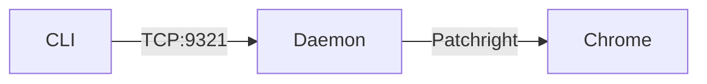

# patchright-cli

[](https://pypi.org/project/patchright-cli/)
[](https://pypi.org/project/patchright-cli/)
[](https://pypi.org/project/patchright-cli/)
[](LICENSE)
[](https://github.com/AhaiMk01/patchright-cli/actions)
[](https://github.com/AhaiMk01/patchright-cli)
[](https://github.com/AhaiMk01/patchright-cli/issues)
[](https://github.com/astral-sh/ruff)

Anti-detect browser automation CLI. Same command interface as [Microsoft's playwright-cli](https://github.com/microsoft/playwright-cli) but using [Patchright](https://github.com/kaliiiiiiiiii/patchright-python) (undetected Playwright fork) to bypass bot detection.

[Install](#install) · [Quick Start](#quick-start) · [Commands](#-commands) · [Snapshots](#snapshots) · [Agent Integration](#agent-integration)

### Highlights

| | Feature |
|---|---|
| :shield: | Bypasses Akamai, Cloudflare, and other anti-bot systems |
| :rocket: | Same command interface as playwright-cli — zero learning curve |
| :robot: | Built for AI agents (Claude Code, Codex, etc.) with YAML snapshots |
| :zap: | Daemon architecture — browser stays open between commands |
| :package: | `pip install` / `uvx` — no Docker, no config files |
| :lock: | Persistent profiles for maintaining login sessions |

---

## Install

> [!TIP]
> **Just paste this into your AI coding agent — it will do the rest:**
>
> ```
> Install and set up patchright-cli by following the instructions here:
> https://raw.githubusercontent.com/AhaiMk01/patchright-cli/main/docs/installation.md
> ```
>
> Your agent handles the install, browser setup, and skill configuration automatically.

<details>
<summary><b>For LLM Agents</b></summary>

```bash
curl -s https://raw.githubusercontent.com/AhaiMk01/patchright-cli/main/docs/installation.md
```

</details>

> [!IMPORTANT]
> **Requirements:** Python 3.10+ and Google Chrome

```bash
# Recommended — always runs latest version, no install needed
uvx patchright-cli open https://example.com
```

<details>
<summary><b>Other install methods</b></summary>

```bash
# Via pip
pip install patchright-cli
patchright-cli open https://example.com
patchright-cli close

# Update
pip install --upgrade patchright-cli
```

**From source:**

```bash
git clone https://github.com/AhaiMk01/patchright-cli.git
cd patchright-cli
uv venv && uv pip install -e .
python -m patchright install chromium
```

</details>

### Docker

A prebuilt image is available from GHCR:

```bash
docker pull ghcr.io/ahaimk01/patchright-cli:latest
```

By default the container runs `patchright-cli` directly, so it can be used for normal CLI commands:

```bash
docker run --rm ghcr.io/ahaimk01/patchright-cli:latest --help
docker run --rm ghcr.io/ahaimk01/patchright-cli:latest profile-list
```

Browser sessions live inside the container, so for a sequence of standalone CLI commands keep the same container running:

```bash
docker run --rm -it \
  --name patchright-cli \
  -v patchright-profiles:/root/.patchright-cli \
  --entrypoint /bin/sh \
  ghcr.io/ahaimk01/patchright-cli:latest

uv run patchright-cli open https://example.com --headless
uv run patchright-cli snapshot
uv run patchright-cli close
```

For MCP over stdio, set `PATCHRIGHT_CLI_MODE=mcp-stdio` and keep stdin attached. The volumes keep logins and output after the container exits:

```bash
docker run --rm -i \
  -e PATCHRIGHT_CLI_MODE=mcp-stdio \
  -v ./patchright:/patchright \
  -v patchright-profiles:/root/.patchright-cli \
  ghcr.io/ahaimk01/patchright-cli:latest
```

For a long-running MCP server over Streamable HTTP, set `PATCHRIGHT_CLI_MODE=mcp-http`:

```bash
docker run -d \
  --name patchright-mcp \
  -p 127.0.0.1:9090:9090 \
  -e PATCHRIGHT_CLI_MODE=mcp-http \
  -e PATCHRIGHT_CLI_MCP_TOKEN=replace-with-a-long-random-token \
  -v ./patchright:/patchright \
  -v patchright-profiles:/root/.patchright-cli \
  ghcr.io/ahaimk01/patchright-cli:latest
```

The HTTP MCP endpoint is then available at `http://localhost:9090/mcp`. The MCP server defaults to headless mode in the image and uses `/patchright` as its filesystem root. CLI commands inside the container still need `--headless`, since there is no display.

An example `compose.yml` is included in the repository. It requires a token:

```bash
PATCHRIGHT_CLI_MCP_TOKEN=replace-with-a-long-random-token docker compose up -d
```

Always set `PATCHRIGHT_CLI_MCP_TOKEN` for the HTTP server in Docker, even though both examples publish the port on `127.0.0.1` only. The server binds `0.0.0.0` inside the container, which turns off FastMCP's Host-header check, and the endpoint gives full control of the browser and its saved logins.

---

## Quick Start

```bash
# Launch undetected Chrome and navigate
patchright-cli open https://example.com

# Take a snapshot to see interactive elements with refs
patchright-cli snapshot

# Interact using refs from the snapshot
patchright-cli click e2
patchright-cli fill e5 "search query"
patchright-cli press Enter

# Take a screenshot
patchright-cli screenshot

# Close the browser
patchright-cli close
```

---

## Architecture



| Component | Role |
|-----------|------|
| **Daemon** (`daemon.py`) | Long-running process managing browser sessions via Patchright. Auto-starts on first `open`. |
| **CLI** (`cli.py`) | Thin client — connects, sends command, prints result, disconnects. Browser stays open. |
| **Snapshot** (`snapshot.py`) | Playwright `aria_snapshot()` accessibility tree, annotated with sequential `[ref=eN]` handles for element targeting. |

---

<details>
<summary><h2>📖 Commands</h2></summary>

### Core
```bash
patchright-cli open [url]              # Launch browser
patchright-cli open --profile=work     # Named profile any session can use (logins persist)
patchright-cli open --headless         # Run headless
patchright-cli open --profile=./dir    # A value with / or \ is a profile directory
patchright-cli --tab <name> open <url> # Named tab: shared browser, own page/refs
patchright-cli open --mobile           # Emulate a generic mobile device (Pixel 7)
patchright-cli open --device="Pixel 5" # Emulate a specific Playwright device
patchright-cli goto <url>              # Navigate
patchright-cli click <ref>             # Click element
patchright-cli click <ref> right       # Right-click
patchright-cli click <ref> --modifiers=Alt,Shift
patchright-cli dblclick <ref>          # Double-click
patchright-cli dblclick <ref> --modifiers=Shift
patchright-cli fill <ref> <value>      # Fill text input
patchright-cli fill <ref> <value> --submit  # Fill and press Enter
patchright-cli type <text>             # Type via keyboard
patchright-cli type <text> --submit    # Type and press Enter
patchright-cli hover <ref>             # Hover over element
patchright-cli select <ref> <value>    # Select dropdown option
patchright-cli check <ref>             # Check checkbox
patchright-cli uncheck <ref>           # Uncheck checkbox
patchright-cli drag <from> <to>        # Drag and drop
patchright-cli snapshot                # Accessibility snapshot
patchright-cli snapshot -i             # Interactive elements only (recommended)
patchright-cli snapshot --depth=3      # Limit depth
patchright-cli snapshot --selector=CSS  # Snapshot a CSS-scoped subtree
patchright-cli snapshot <ref>          # Snapshot element subtree
patchright-cli snapshot --filename=f   # Save to custom path
patchright-cli find "text"             # Search snapshot for text
patchright-cli find --regex "a|b"      # Search by regex
patchright-cli find "text" --all       # Include text/paragraph nodes
patchright-cli find "text" --limit=50  # Cap hits (default 20)
patchright-cli eval <expr>             # Run JavaScript
patchright-cli eval --file=script.js   # Run JS from file
patchright-cli run-code <code>         # Run JS with return value
patchright-cli run-code --file=f.js    # Run JS from file
patchright-cli screenshot              # Page screenshot
patchright-cli screenshot --full-page  # Full scrollable page
patchright-cli screenshot <ref>        # Element screenshot
patchright-cli screenshot --filename=f # Save to custom path
patchright-cli screenshot --hires      # Capture at device pixel ratio
patchright-cli close                   # Close session
```

### Navigation
```bash
patchright-cli go-back
patchright-cli go-forward
patchright-cli reload
patchright-cli wait 500                 # Wait a fixed number of milliseconds
patchright-cli wait --url="**/dashboard" # Wait for the URL to match (`*` never crosses a `/`)
patchright-cli wait-for <ref>           # Wait until an element is visible
patchright-cli wait-for <ref> --state=hidden
```

### Keyboard / Mouse
```bash
patchright-cli press Enter
patchright-cli keydown Shift
patchright-cli keyup Shift
patchright-cli mousemove 150 300
patchright-cli mousedown [button]
patchright-cli mouseup [button]
patchright-cli mousewheel 0 100
```

### Dialog
```bash
patchright-cli dialog-accept [text]    # Accept next alert/confirm/prompt
patchright-cli dialog-dismiss          # Dismiss next dialog
```

### Upload / Resize
```bash
patchright-cli upload ./file.pdf       # Upload to first file input
patchright-cli upload ./file.pdf e5    # Upload to specific input
patchright-cli resize 1920 1080        # Resize viewport
```

### Tabs
```bash
patchright-cli tab-list
patchright-cli tab-new [url]
patchright-cli tab-select <index>
patchright-cli tab-close [index]
```

### State Persistence
```bash
patchright-cli state-save [file]       # Save cookies + localStorage
patchright-cli state-load <file>       # Restore saved state
```

### Storage
```bash
# Cookies
patchright-cli cookie-list
patchright-cli cookie-list --domain=example.com
patchright-cli cookie-list --path=/api
patchright-cli cookie-get <name>
patchright-cli cookie-set <name> <value>
patchright-cli cookie-set <name> <value> --domain=example.com --httpOnly --secure
patchright-cli cookie-set <name> <value> --path=/ --sameSite=Lax --expires=1735689600
patchright-cli cookie-delete <name>
patchright-cli cookie-clear

# localStorage
patchright-cli localstorage-list
patchright-cli localstorage-get <key>
patchright-cli localstorage-set <key> <value>
patchright-cli localstorage-delete <key>
patchright-cli localstorage-clear

# sessionStorage
patchright-cli sessionstorage-list
patchright-cli sessionstorage-get <key>
patchright-cli sessionstorage-set <key> <value>
patchright-cli sessionstorage-delete <key>
patchright-cli sessionstorage-clear
```

### Request Mocking
```bash
patchright-cli route "**/*.jpg" --status=404
patchright-cli route "https://api.example.com/**" --body='{"mock":true}'
patchright-cli route "**/*" --content-type=application/json --body='{"ok":true}'
patchright-cli route "**/*" --header=X-Custom:value
patchright-cli route "**/*" --remove-header=Content-Type
patchright-cli route-list
patchright-cli unroute "**/*.jpg"
patchright-cli unroute                 # Remove all routes
```

### Tracing / Video / PDF
```bash
patchright-cli tracing-start
patchright-cli tracing-stop            # Saves .zip trace file
patchright-cli video-start             # Start video recording (CDP screencast)
patchright-cli video-stop              # Stop and save video (requires ffmpeg for .webm)
patchright-cli video-stop --filename=recording.webm
patchright-cli show --annotate          # Ask a human to mark up the page, wait for it
patchright-cli video-show-actions       # Annotate each action in the recording
patchright-cli video-hide-actions       # Stop annotating actions
patchright-cli pdf --filename=page.pdf
```

### Network
```bash
patchright-cli network                 # Network request log
patchright-cli network --static        # Include static resources
patchright-cli network --clear         # Clear log after printing
patchright-cli network-state-set offline  # Simulate offline mode
patchright-cli network-state-set online   # Restore connectivity
```

### DevTools
```bash
patchright-cli console                 # All console messages
patchright-cli console warning         # Filter by level
patchright-cli console --clear         # Clear after printing
```

### Output
```bash
patchright-cli --raw eval --file=s.js  # Raw output (no page/snapshot decoration)
patchright-cli --raw snapshot > p.yml  # Pipe raw snapshot to file
```

### Setup
```bash
patchright-cli install --skills        # Auto-install skills for detected AI agents
```

### Sessions
```bash
patchright-cli -s=mysession open https://example.com
patchright-cli -s=mysession click e6
patchright-cli -s=mysession close
patchright-cli list                    # List all sessions
patchright-cli close-all
patchright-cli kill-all
patchright-cli delete-data             # Delete the profile named after the session
patchright-cli profile-list           # Profiles, size, and which session uses each
patchright-cli profile-delete <name>  # Delete an idle named profile
patchright-cli --port=9322 open        # Custom daemon port
```

</details>

---

## Agent Integration

Works with Claude Code, Cursor, Gemini CLI, Codex, and [40+ other agents](https://github.com/vercel-labs/skills).

```bash
# Install skill for all detected agents (recommended)
npx skills add AhaiMk01/patchright-cli
```

<details>
<summary><b>Other install methods</b></summary>

```bash
# Via patchright-cli itself
pip install patchright-cli
patchright-cli install --skills

# Or just tell your agent:
# "Install patchright-cli skill from https://raw.githubusercontent.com/AhaiMk01/patchright-cli/main/skills/patchright-cli/SKILL.md"
```

</details>

### MCP server

MCP support is optional so the base CLI install stays small:

```bash
pip install 'patchright-cli[mcp]'

# stdio (default)
patchright-cli mcp

# Streamable HTTP
patchright-cli mcp --http --host=127.0.0.1 --port=8000
```


The HTTP endpoint is `/mcp`. Set `PATCHRIGHT_CLI_MCP_TOKEN` to require `Authorization: Bearer <token>` on every request, and always set it before binding to `0.0.0.0`.

File paths passed to MCP tools (uploads, state and cookie files, screenshot/PDF/snapshot output, profile directories) must be absolute and beneath the MCP root, so a client cannot reach arbitrary host files. Outputs without a path land in `<root>/output/`, which `browser_delete_output` can clean up. `patchright_eval` and `patchright_run_code` still run arbitrary JavaScript in the page, so protect HTTP deployments regardless.

| Variable | Default | Effect |
|---|---|---|
| `PATCHRIGHT_CLI_MCP_TOKEN` | unset (no auth) | Bearer token required by the HTTP transport |
| `PATCHRIGHT_CLI_MCP_ROOT` | working directory | Root that tool file paths must sit beneath |
| `PATCHRIGHT_CLI_MCP_UNRESTRICTED_FILESYSTEM` | unset | `1` drops the path check and enables `patchright_install_skills` |
| `PATCHRIGHT_CLI_MCP_HEADLESS` | unset (headed) | `1` makes `patchright_open` default to headless, for hosts without a display |
| `PATCHRIGHT_CLI_MCP_DAEMON_PORT` | `9321` | Daemon port the tools talk to |

### Skill docs

| File | Topic |
|------|-------|
| [`SKILL.md`](skills/patchright-cli/SKILL.md) | Main skill — commands, options, patterns |
| [`snapshot-refs.md`](skills/patchright-cli/references/snapshot-refs.md) | Snapshots, element refs, `-i` flag |
| [`session-management.md`](skills/patchright-cli/references/session-management.md) | Named sessions, profiles, CDP, dashboard |
| [`request-mocking.md`](skills/patchright-cli/references/request-mocking.md) | Route mocking, network state |
| [`storage-state.md`](skills/patchright-cli/references/storage-state.md) | Cookies, localStorage, sessionStorage |
| [`running-code.md`](skills/patchright-cli/references/running-code.md) | eval, run-code, `--file`, stdin |
| [`tracing.md`](skills/patchright-cli/references/tracing.md) | Trace recording and debugging |
| [`video-recording.md`](skills/patchright-cli/references/video-recording.md) | Video, codegen, screenshot, PDF |

---

## Star History

<a href="https://star-history.com/#AhaiMk01/patchright-cli&Date">
 <picture>
   <source media="(prefers-color-scheme: dark)" srcset="https://api.star-history.com/svg?repos=AhaiMk01/patchright-cli&type=Date&theme=dark" />
   <source media="(prefers-color-scheme: light)" srcset="https://api.star-history.com/svg?repos=AhaiMk01/patchright-cli&type=Date" />
   
 </picture>
</a>

---

<details>
<summary><h2>Differences from playwright-cli</h2></summary>

patchright-cli aims for full command parity with [Microsoft's playwright-cli](https://github.com/microsoft/playwright-cli). The following playwright-cli features are **intentionally not implemented** due to Patchright's architecture:

| Feature | Reason |
|---------|--------|
| `--browser=firefox/webkit/msedge` | Patchright only supports Chromium/Chrome. Anti-detect patches are Chrome-specific. |
| `--extension` | Browser extension connection not supported. Patchright uses CDP directly. |
| `install` / `install-browser` | Use `python -m patchright install chromium` instead. |

All other commands and options are fully supported.

</details>

---

## Disclaimer

> [!WARNING]
> This tool is provided for **authorized security testing, legitimate automation, and educational purposes** only. Users are solely responsible for ensuring their use complies with applicable laws and the terms of service of any websites they interact with. The authors do not endorse or encourage any unauthorized access, scraping, or circumvention of security measures. Use at your own risk.

---

## Credits

This project builds on the work of:

- **[Patchright](https://github.com/Kaliiiiiiiiii-Vinyzu/patchright)** by [@Kaliiiiiiiiii-Vinyzu](https://github.com/Kaliiiiiiiiii-Vinyzu) — the undetected Playwright fork that makes this possible. All anti-detect capabilities come from Patchright.
- **[playwright-cli](https://github.com/microsoft/playwright-cli)** by Microsoft — the original CLI that patchright-cli's command interface is modeled after.
- **[camoufox-cli](https://github.com/Bin-Huang/camoufox-cli)** by [@Bin-Huang](https://github.com/Bin-Huang) — inspiration for the CLI-first approach to anti-detect browser automation and the SKILL.md agent integration pattern.

---

## License

Apache 2.0 — same as [playwright-cli](https://github.com/microsoft/playwright-cli)
